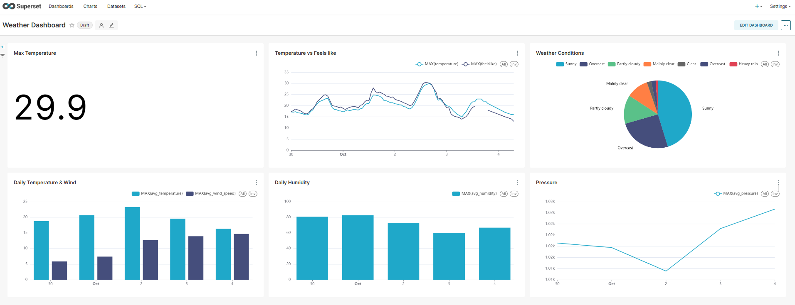
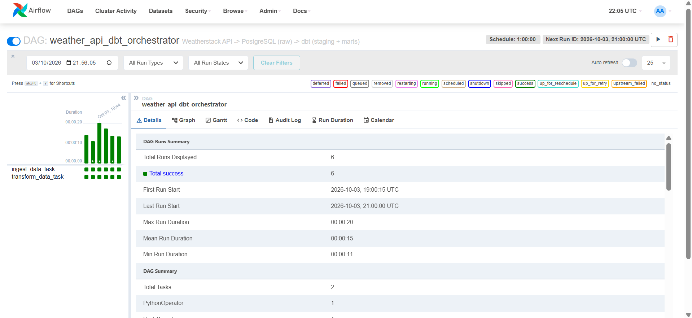
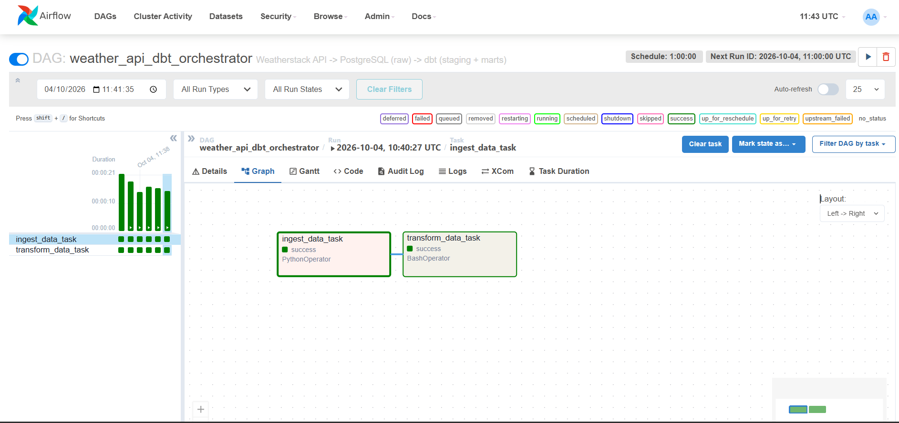
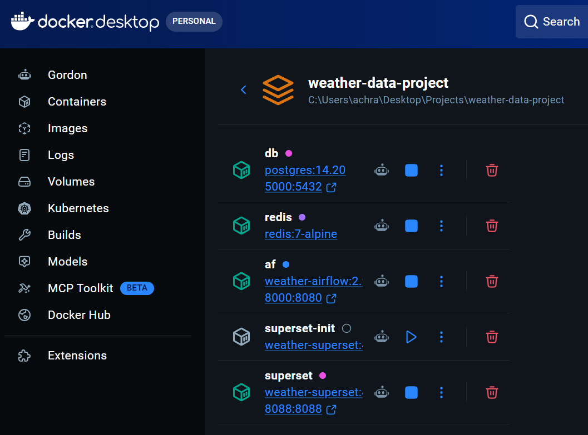

# Weather Data Pipeline

An hourly ELT pipeline: the **Weatherstack API** feeds **PostgreSQL**, **dbt** transforms the data, **Airflow** orchestrates the runs and **Superset** visualizes the results. Everything runs in **Docker**.

```
Weatherstack API ─► api_request.py ─► insert_records.py ─► PostgreSQL (dev.raw_weather_data)
                                                                │
                              Airflow DAG (hourly) ─────────────┤
                                                                ▼
                         dbt: stg_weather_data ─► daily_average / weather_report
                                                                │
                                                     Superset dashboard (+ Redis cache)
```

## Stack
| Service | Role | URL |
|---|---|---|
| PostgreSQL 14 | Weather data + Airflow and Superset metadata | `localhost:5000` |
| Airflow 2.9 | Orchestration (`weather_api_dbt_orchestrator`, hourly) | http://localhost:8000 |
| dbt 1.9 | Transformations and tests (staging → marts) | runs from Airflow |
| Superset 4.1 | Dashboard | http://localhost:8088 |
| Redis 7 | Superset cache and sessions | internal |

## Data collected
Each run stores one reading per city: `temperature`, `feelslike`, `humidity`, `pressure`, `wind_speed`, `weather_description` and the local observation time.

## Project layout
```
api-request/        Extract (Weatherstack) + Load (PostgreSQL)
airflow/            Custom image (with dbt) + DAG orchestrator.py
dbt/                profiles.yml + my_project (staging, mart, tests)
superset/           Custom image + superset_config.py (Redis)
postgres/           Init scripts: airflow_db, superset_db
docker-compose.yml
```

## Run
```bash
cp .env.example .env        # fill in the Weatherstack API key and passwords
docker compose up -d --build
```
1. Airflow: enable the `weather_api_dbt_orchestrator` DAG. Each run executes `ingest_data_task` then `transform_data_task` (`dbt build`).
2. Superset: the `weather_db` connection is created automatically. Build charts on `dev.daily_average` and `dev.weather_report`.

Optional manual dbt run: `docker compose --profile dbt run --rm dbt build`.
To run without consuming API quota: set `USE_MOCK_DATA=true` in `.env`.

## dbt models
- `stg_weather_data`: one row per city and hour (deduplicated), `time` renamed to `weather_time_local`, `inserted_at` converted to the city's local time
- `daily_average`: daily averages per city (temperature, feels-like, wind speed, humidity, pressure)
- `weather_report`: hourly detail for the dashboard
- Tests: `unique` / `not_null` on the key columns, run with every `dbt build`

## Screenshots

**Superset: Weather Dashboard**


**Airflow: DAG runs (Grid view)**


**Airflow: task dependencies (Graph view)**


**Docker: running services**

